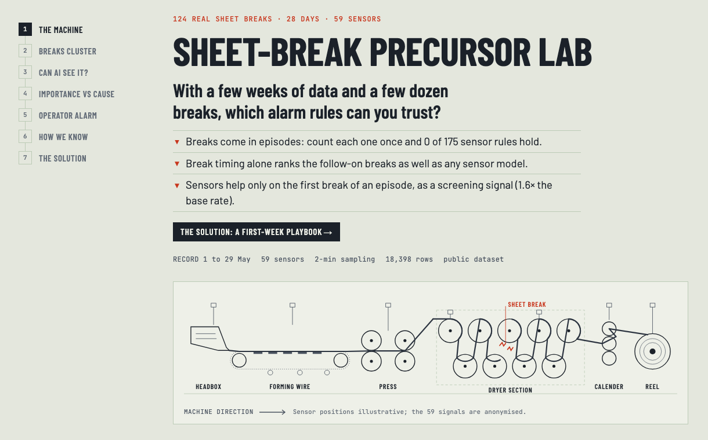
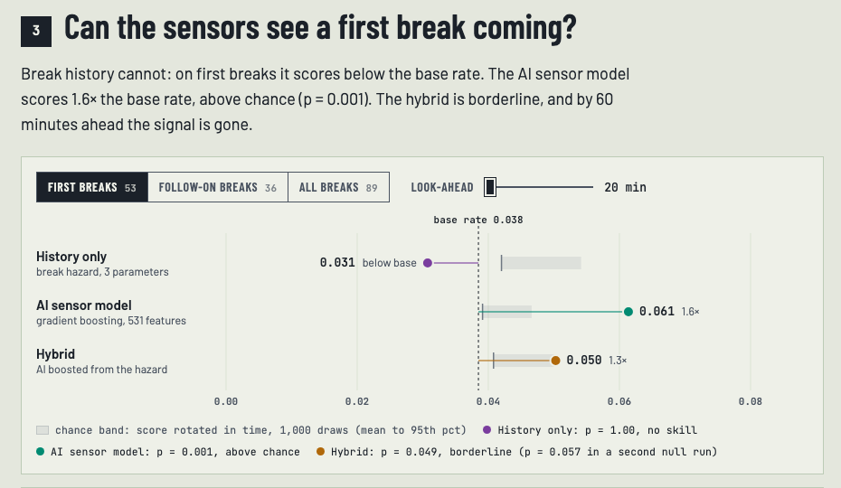
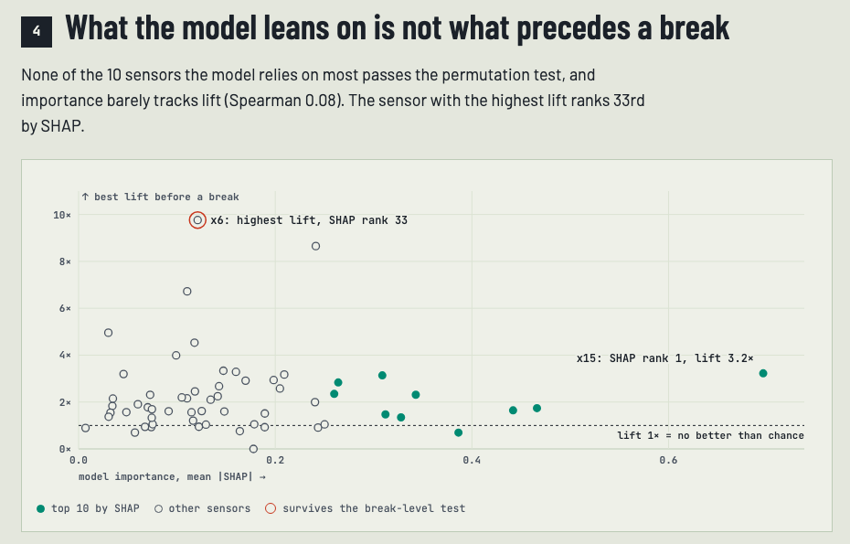
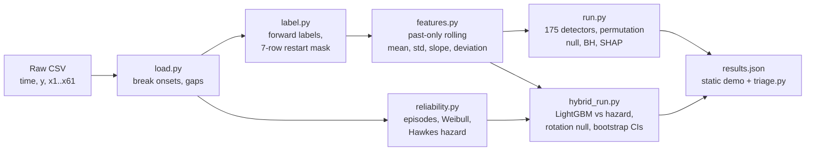
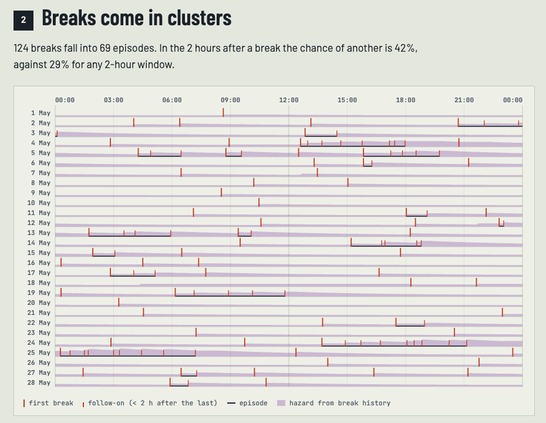

<div align="center">

# Sheet-break precursor lab

**Which alarm rules can you trust when a line has a few weeks of data and a few dozen failures?**<br>
A rare-event analysis of 124 real paper-machine sheet breaks, with a first-week playbook and a triage tool you can run on your own CSV.

[](tests/)
[](LICENSE)
[](DATA.md)
[](requirements.txt)
[](package.json)

**[Live demo](https://ibiraheel.com/demos/sheet-break-precursor-lab/)** · [Method](METHOD.md) · [Solution playbook](SOLUTION.md)

<a href="https://ibiraheel.com/demos/sheet-break-precursor-lab/"></a>

</div>

---

## Question, answer, solution

**The question.** On a continuous line, failures are rare, expensive and clustered. With a few weeks of data and a few dozen failures, which alarm rules can you trust? How do you tell a real precursor from one bad evening, or from a signal the model only leans on?

**The measured answer** (124 sheet breaks, 28 days, 59 sensors at 2-minute sampling):

- The 124 breaks are really **69 episodes**. Scored one break at a time, 1 of 175 sensor rules passes a permutation test, and 7 of its 8 hits fall in one 10-hour evening. Counted once per episode, **0 of 175 hold**.
- **Break history alone** (a 3-parameter hazard) ranks follow-on breaks as well as any sensor model.
- On the **first break of an episode**, where history has no skill, the sensor model ranks the 20-minute windows at **1.6× the base rate** (p = 0.001). That is a screening signal, not yet an alarm.
- None of the 10 signals the model leans on most (SHAP) survives the detector test. SHAP rank vs lift: Spearman **0.08**.

**The solution.** A five-step first-week playbook ([SOLUTION.md](SOLUTION.md)) and a small CLI, `pipeline/triage.py`, that runs it on one CSV. It sizes the downtime, routes every event (follow-on → hazard or watch window, first-in-episode → sensor screening) and labels every candidate detector *holds per episode*, *one-episode artefact* or *noise*.

## Key results

Every number below comes from `src/data/results.json` or [METHOD.md](METHOD.md).

| Measure | Value |
| --- | --- |
| Record | 18,398 rows · 59 sensors · 1 to 29 May · 2-min sampling |
| Breaks → episodes (gap < 2 h chained) | 124 → 69 (69 first-in-episode, 55 follow-on) |
| Chance of another break within 2 h of a break | 42%, vs 29% for any 2-hour window |
| Weibull shape *k* (risk highest right after a break) | 0.87 (95% CI 0.78 to 0.99) |
| Hawkes branching ratio · AIC vs exponential | 0.40 · 1160.3 vs 1169.7 |
| Post-break downtime (inferred from timestamp gaps) | 20 min per break · 41.9 h over 28 days · 1.5 line-hours a day |
| Single-sensor rules that survive, break-level (BH q < 0.05) | 1 of 175 (`x6` level, q = 0.035) |
| Rules that survive, episode-level | **0 of 175** (`x6` covers 2 of 50 episodes, q = 0.58) |
| Top-10 SHAP signals that survive | 0 of 10 · Spearman SHAP vs lift 0.08 |
| Fake break times (null calibration) | 0 survivors in 20 of 20 runs |

## AI vs baseline

The AI component is a LightGBM model on 531 past-only sensor features. The baseline is a 3-parameter self-exciting (Hawkes) hazard that uses break history only. PR-AUC at a 20-minute horizon, 89 out-of-sample breaks, forward-chaining episode-safe folds.

| Slice | History only (Hawkes) | AI sensor model | Hybrid (AI boosted from the hazard) | Base rate | Verdict |
| --- | --- | --- | --- | --- | --- |
| First break of an episode (53) | 0.031 | **0.061** (p = 0.001 vs rotation null) | 0.050 (p = 0.049, borderline) | 0.038 | **AI wins.** History scores below the base rate. Holds with ≥ 10 min lead (0.037 vs 0.023, p = 0.014). |
| Follow-on breaks (36) | **0.148** | 0.044 | 0.126 | 0.019 | **History wins.** Hybrid − hazard CI −0.054 to +0.024: a tie at best. |
| All breaks (89) | 0.102 | 0.096 | **0.121** | 0.056 | **Hybrid edges ahead, not proven.** Hybrid − hazard CI +0.002 to +0.043. |
| First break, 60-min horizon | 0.105 | 0.122 (p = 0.14) | 0.116 | 0.117 | **Loss.** The sensor signal is short-range. |

Product grade alone does not explain the first-break result (grade-only model 0.045, p = 0.28). The sensor alarm also flickers: about 5 false alarms per shift at 10% alarm-on time, which is why it is a screening list and not an operator alarm.

<table>
<tr>
<td width="50%"></td>
<td width="50%"></td>
</tr>
<tr>
<td align="center"><sub>First breaks: the sensor model clears the chance band, history does not.</sub></td>
<td align="center"><sub>What the model leans on is not what precedes a break.</sub></td>
</tr>
</table>

## How it works



- **Labels** look forward *h* minutes from each row; rows right after a restart are masked (7 rows, measured from the post-break transient).
- **Detectors** are single-signal level, slope and deviation rules with thresholds set on earlier weeks only. Each is scored by lift against a 5,000-draw permutation null, per break and per episode, with Benjamini-Hochberg.
- **Models** run with forward-chaining, episode-safe folds. Each is judged against a chance null that rotates its own score in time, so flicker and alarm-on time stay fixed.
- The demo reads the precomputed `src/data/results.json`. It needs no API keys and no server.

<p align="center"><br><sub>Breaks come in episodes: 124 breaks, 69 episodes.</sub></p>

## Quickstart

The raw CSV is not redistributed. Request it through the paper (see [DATA.md](DATA.md)) and save it as `data/raw/processminer.csv`.

```bash
# Python pipeline
uv venv .venv && uv pip install -r requirements.txt --python .venv/bin/python
export OMP_NUM_THREADS=2
.venv/bin/python -I pipeline/run.py        data/raw/processminer.csv src/data/results.json   # ~1 min
.venv/bin/python -I pipeline/hybrid_run.py data/raw/processminer.csv src/data/results.json   # ~6 min
.venv/bin/python -I pipeline/lead_check.py data/raw/processminer.csv src/data/results.json   # after hybrid_run

# Tests (38: hand calculations, known-parameter recovery, triage reproduces the pipeline)
.venv/bin/python -I -m pytest -q tests

# The triage tool, on this data or your own CSV (time, y, x1..xn)
.venv/bin/python -I pipeline/triage.py data/raw/processminer.csv            # cost, clustering, routing, detectors
.venv/bin/python -I pipeline/triage.py data/raw/processminer.csv --model    # + first-break sensor-model check
# flags: --gap-min 120  --horizon-min 20  --perms 5000  --grade x28  --out triage.json

# Demo
npm install
npm run dev        # local dev server
npm run build      # static build in dist/, served under /demos/sheet-break-precursor-lab/
```

## Repo layout

```
pipeline/        load, label, features, stats, reliability, hybrid, run scripts, triage CLI
tests/           38 pytest tests
src/             React + Vite demo; src/data/results.json is the pipeline output
docs/img/        screenshots
METHOD.md        equations, assumptions, validation, full results
SOLUTION.md      first-week playbook, decision rules, triage tool
DATA.md          dataset source, licence, how to obtain it
```

## Data

Real data, no simulation. Ranjan, C., Reddy, M., Mustonen, M., Paynabar, K., Pourak, K. (2018). *Dataset: Rare Event Classification in Multivariate Time Series.* [arXiv:1809.10717](https://arxiv.org/abs/1809.10717). Released by ProcessMiner Inc.

Licence: [CC BY-NC-SA 4.0](https://creativecommons.org/licenses/by-nc-sa/4.0/). This project is non-commercial, and the derived results in `src/data/` are shared under the same licence. The code is MIT. The raw CSV is not included; see [DATA.md](DATA.md).

## Limitations

- **One public dataset, one machine, 28 days.** The playbook has not been validated on a production line.
- **Small sample.** 74 breaks are scored in the detector test and 53 first breaks in the model test. The first-break signal beats chance but is small (PR-AUC 0.061 vs a 0.038 base rate) and gone by 60 minutes.
- **Anonymised signals.** No physical meaning is claimed for `x6` or any sensor; a process engineer would have to name them.
- **Downtime is inferred.** 103 of 107 timestamp gaps start right after a break and are read as post-break downtime. The dataset does not label them.
- **Single-signal rules only.** Multi-signal rules are out of scope, and the hybrid's first-break skill is borderline (p = 0.049 in one null run, 0.057 in another).

---

Built by **Ibi Raheel**, mechanical engineer building AI tools · [ibiraheel.com](https://ibiraheel.com)
